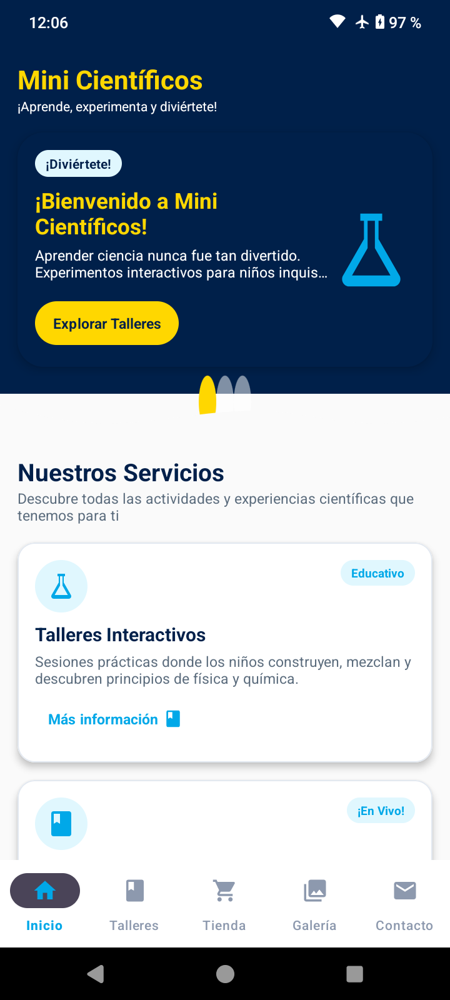
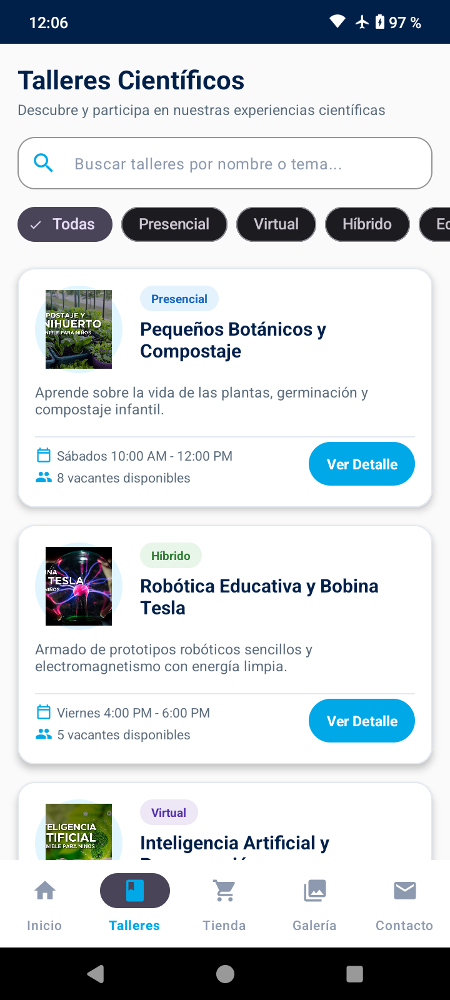
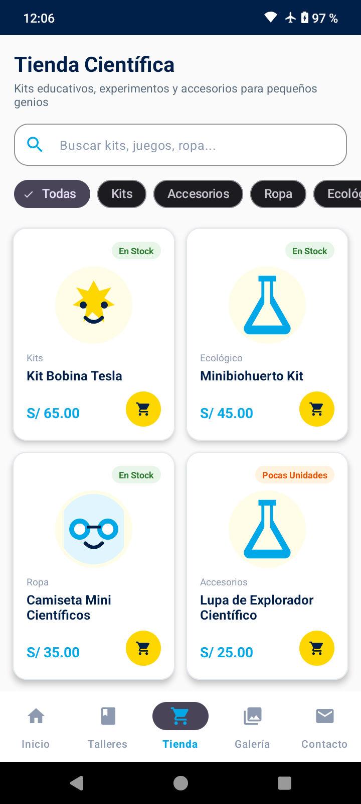
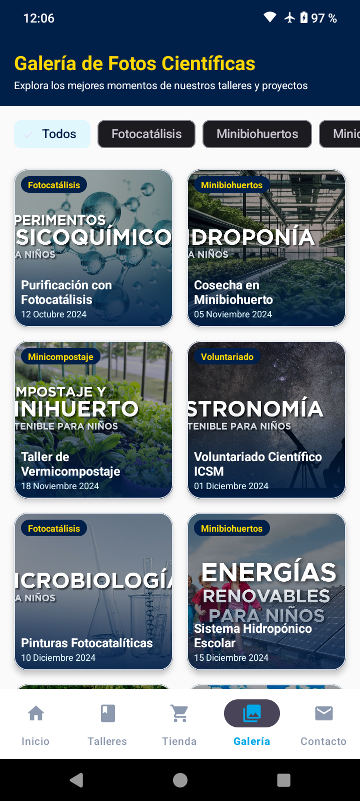
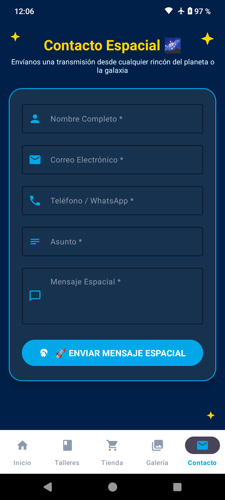

# 🔬 Mini Científicos - App Android (Java Nativo)

## 📌 Descripción del Proyecto

<table>
  <tr>
    <td valign="middle" width="65%">
      <strong>Mini Científicos</strong> es una aplicación Android nativa desarrollada íntegramente en <b>Java</b>, basada en la plataforma web oficial (<a href="https://minicientificos-proces.vercel.app" target="_blank">minicientificos-proces.vercel.app</a>). Su propósito es despertar la curiosidad científica en niños, padres de familia y colegios mediante talleres interactivos, experimentos en vivo, espectáculos y kits educativos.<br><br>
      El sistema destaca por su arquitectura modular en fases (Fase 1 a Fase 4), UI/UX bajo el sistema de diseño <b>"Kawaii Científico"</b> (Material Design 3), renderizado gráfico 3D nativo mediante Canvas, reproductor de video ExoPlayer nativo, asistente recomendador inteligente y un motor de e-commerce completo con validación de envío, cupones de descuento e integración con WhatsApp.
    </td>
    <td align="center" valign="middle" width="35%">
      <picture>
        <source srcset="https://github.com/mrpeak-1/MiniCientificos-Android/blob/main/.github-assets/android.gif?raw=true">
        
      </picture>
    </td>
  </tr>
</table>

---

## 📱 Interfaz de Usuario Principal

| Inicio | Talleres | Tienda | Galería | Contacto |
| :---: | :---: | :---: | :---: | :---: |
|  |  |  |  |  |

---

## 🛍️ Módulos de E-commerce, Checkout Paso 2 e Interacciones

| Personajes | Detalle de Taller | Detalle de Producto | Carrito Paso 1 | Pedido WhatsApp |
| :---: | :---: | :---: | :---: | :---: |
|  |  |  |  |  |

---

## 🌟 Módulos y Funcionalidades Principales

### 🏠 1. Home (`HomeFragment`)
* **Hero Slider Promocional:** Carrusel dinámico mediante `ViewPager2` + `TabLayout` con rotación automática.
* **Tarjetas 3D de Servicios:** Modales informativos (`ServicioHomeBottomSheet`) para Talleres Científicos, Eventos y Ferias Científicas.
* **12 Píldoras de Talleres (Edición 2026):**
  * Cabeceras oficiales por área: `🚀 Ciencia y Tecnología` y `🌎 Naturaleza y Planeta`.
  * Tarjetas pastel con bordes de color personalizados (`#818CF8`, `#F59E0B`, `#FB923C`, `#C084FC`, etc.) y badges de modalidad (`PRESENCIAL` en naranja / `VIRTUAL` en azul).
* **Botón Verde 3D y Asistente Recomendador de Talleres:**
  * Modal interactivo (`AsistenteTallerBottomSheet`) presentado por **Titan** y **Tesla**.
  * Cuestionario rápido mediante Chips interactivos con colores vivos, animaciones de escala 3D (`1.12x`), opacidad graduada y bordes dorados (`#FDC500`).
  * Recomendación instantánea con navegación directa a talleres y asesoría por WhatsApp.
* **Mini Planeta 3D Interactivo:**
  * Proyección esférica 3D en Canvas nativo (`Planet3DView` + `MiniPlanetaController`) con rotación 360° por gestos táctiles e insignias científicas en tiempo real (`PlanetaExperimentoBottomSheet`).
* **Sección Video Scroll Nativo ExoPlayer:**
  * Integración de `androidx.media3:media3-exoplayer` para el video promocional de Titan y Tesla.
  * Botón flotante para activar/desactivar audio (`Mute`/`Unmute`) y animaciones Parallax al hacer scroll.
* **Footer Corporativo:** Pie de página con enlaces institucionales y redes sociales.

### 🛒 2. E-Commerce & Checkout Paso 2
* **Catálogo Científico (`ShopFragment`):** Búsqueda reactiva por texto, filtros por categoría (*Peluches, Accesorios, Ropa, Papelería*) y ordenamiento (*Destacados, A-Z, Menor Precio, Mayor Precio*).
* **Detalle de Producto (`ProductoDetalleBottomSheet`):** Selector incremental de unidades con validación de stock y micro-interacciones al agregar al carrito.
* **Gestor Global del Carrito (`CartManager`):** Patrón Singleton reactivo que notifica los cambios en tiempo real a la interfaz (`OnCartChangeListener`) y actualiza el contador/badge del FAB de navegación.
* **Carrito Paso 1 (`CartBottomSheetDialog`):** Resumen de ítems, modificación de cantidades, eliminación y campo para notas/dedicatoria.
* **Checkout Paso 2 (`CheckoutBottomSheetDialog`):**
  * **Sección 1 (Datos de Envío):** Formulario de 7 campos (*Nombre completo, Celular, Correo, Dirección, Distrito, Provincia, Departamento*) con desplegable de los 24 Departamentos del Perú + Callao.
  * **Validación y Animaciones:** Validación estricta del celular de 9 dígitos (iniciando en 9) con animación de sacudida horizontal (*CycleInterpolator*) ante errores.
  * **Persistencia Local:** Opción *"Recordar mis datos de envío"* gestionada de forma cifrada/local en `SharedPreferences` mediante `CheckoutStorageHelper`.
  * **Motor Oficial de Cupones:** Soporte para cupones promocionales (`MINI10` [10%], `CIENCIA20` [20%], `EXPLORADOR15` [15%]) con recálculo dinámico de subtotal, descuento y total estimado en soles.
  * **Recibo Enriquecido para WhatsApp:** Método sobrecargado `abrirPedidoCheckoutCompleto` en `WhatsAppHelper` que envía el detalle del pedido, desglose económico, cupones y la dirección completa de entrega.

### 🧪 3. Talleres y Experimentos (`WorkshopsFragment`)
* Catálogo completo de talleres con filtros por categoría y modalidad, integración con deep linking y panel modal de detalle (`TallerDetalleBottomSheet`).

### 🖼️ 4. Galería (`GalleryFragment` / `GaleriaFragment`)
* Cuadrícula fotográfica interactiva (`GridLayoutManager`) de eventos, ferias y actividades reales.

### 📞 5. Contacto Espacial (`ContactoFragment`)
* Formulario de transmisión espacial e integración directa con WhatsApp para consultas de eventos y colegios.

---

## 🛠️ Tecnologías y Stack Utilizado

* **Lenguaje:** Java 100% (Desarrollo nativo sin Kotlin).
* **Diseño UI/UX:** Material Design 3 (M3) adapto para entorno infantil "Kawaii Científico".
* **Vinculación de Vistas:** `ViewBinding` para un acceso directo, seguro y eficiente a los componentes XML.
* **Multimedia & Video:** `androidx.media3:media3-exoplayer:1.3.1` para la reproducción fluida de video.
* **Gráficos 3D & Canvas:** Proyección matemática esférica customizada en `Planet3DView`.
* **Persistencia:** `SharedPreferences` para el guardado local de datos de envío del usuario.
* **Tipografías:** Google Fonts (`Fredoka`, `Nunito`, `Kalam`, `Poppins`) integradas vía *Downloadable Fonts*.
* **Navegación & Arquitectura:**
  * Patrón Single Activity + Multiple Fragments (`MainActivity`).
  * `BottomNavigationView` para conmutación fluida entre secciones.
  * `BottomSheetDialogFragment` para la presentación de diálogos y modales emergentes.
  * `CartManager` Singleton para la gestión de estado del carrito de compras.

---

## 📁 Estructura del Proyecto

```text
app/src/main/java/com/icsm/minicientificos_android/
├── 📂 adapters/     # Adaptadores de RecyclerView (CartAdapter, CheckoutResumenAdapter, PildoraTallerHomeAdapter, ProductoAdapter, TallerAdapter, etc.)
├── 📂 cart/         # Lógica central del e-commerce (CartItem, CartManager)
├── 📂 controllers/  # Controladores de componentes complejos (HeroSliderController, HeroSliderManager, MiniPlanetaController)
├── 📂 models/       # Modelos POJO (DatosEnvioCliente, PildoraTallerHome, Producto, Taller, etc.) y Catálogos en memoria
├── 📂 ui/           # Fragmentos, BottomSheets (CheckoutBottomSheetDialog, AsistenteTallerBottomSheet, CartBottomSheetDialog, etc.) y Helpers de UI
├── 📂 utils/        # Herramientas globales (WhatsAppHelper, CheckoutStorageHelper)
├── 📂 views/        # Vistas personalizadas en Canvas (Planet3DView)
└── 📄 MainActivity.java # Host principal del BottomNavigation y listeners del carrito
```

---

## 🚀 Cómo Ejecutar el Proyecto

1. **Clonar el repositorio:**
   ```bash
   git clone https://github.com/mrpeak-1/MiniCientificos-Android.git
   ```
2. **Abrir en Android Studio:**
   * Selecciona `Open an Existing Project` y elige la carpeta del proyecto.
3. **Sincronizar Gradle:**
   * Espera a que Android Studio descargue las dependencias y construya la aplicación.
4. **Ejecutar:**
   * Conecta un dispositivo físico Android o inicia un emulador y presiona **Run** (`Shift + F10`).

---

## 👨‍💻 Desarrollado por

| Miguel Córdova | Mateo Vicente | Oscar Quille |
| :---: | :---: | :---: |
| 🚀 Android Developer | 🚀 Android Developer | 🚀 Android Developer |
| <picture></picture> | <picture></picture> | <picture></picture> |

<br>

<p align="center">
  <strong>© 2026 MiniCientíficos. Todos los derechos reservados.</strong>
</p>
